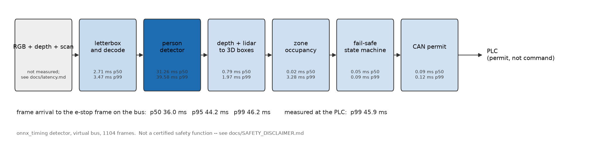
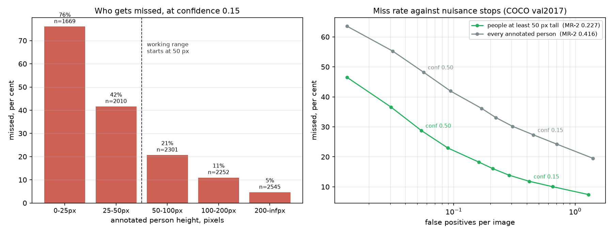
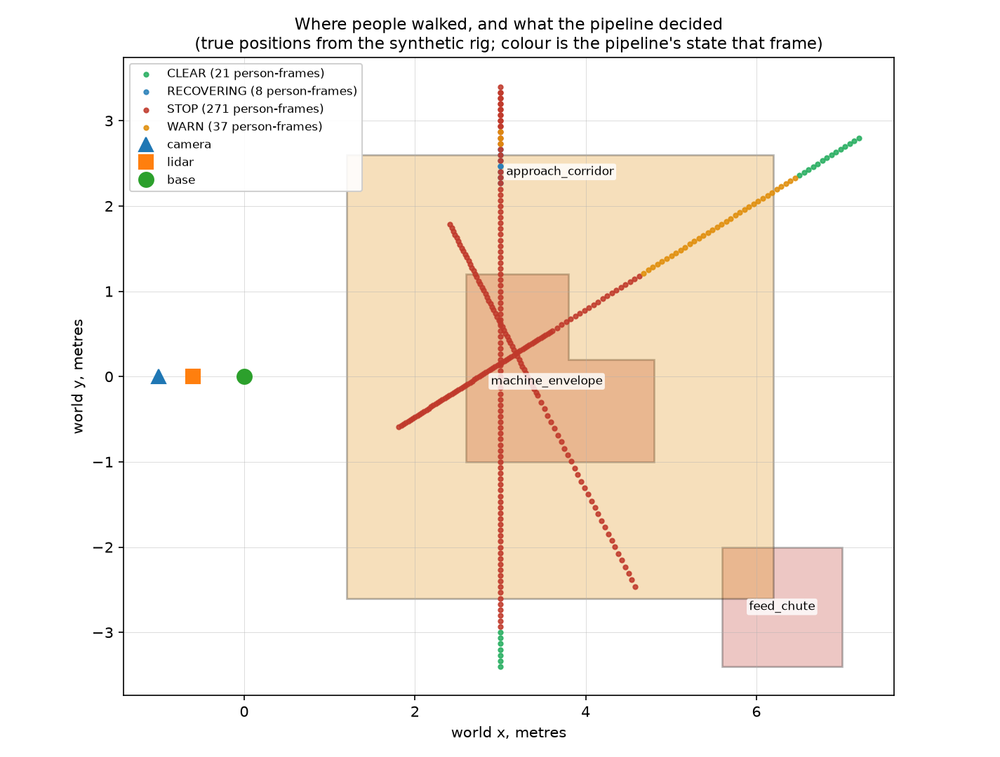
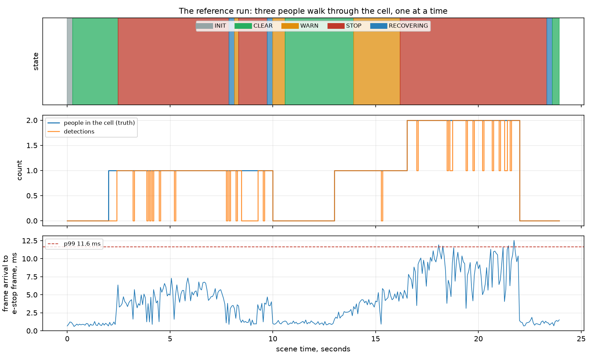

# cv-safety-zone-perception

Detect people, fuse a depth camera and a 2D lidar into 3D boxes on the factory
floor, test those boxes against configured safety zones and publish an
emergency-stop permit over CAN, with the whole path from frame arrival to the
frame on the bus measured.



> ### This is **not a certified safety function**
> It is an engineering demonstrator. Nothing here has been assessed against
> IEC 61508, ISO 13849 or ISO 3691-4, no Performance Level is claimed and it
> must never be the sole protective measure for any machine.
> **Read [docs/SAFETY_DISCLAIMER.md](docs/SAFETY_DISCLAIMER.md) before anything
> else.**

> ### Clean-room reimplementation
> An independent reimplementation of a problem class, built from scratch on
> personal time using public and synthetic data and open-source simulation. It
> is not derived from and contains no material belonging to, any employer or
> client: no employer source code, schematics, calibration data, client data or
> internal documentation.

---

## Run it

```bash
scripts/setup.sh --export        # venv, dependencies and the ONNX detector
sudo scripts/setup_vcan.sh       # a real Linux virtual CAN interface
make demo                        # the whole pipeline, end to end
```

or, without touching the host:

```bash
docker compose -f docker/docker-compose.yml up --build
```

which brings up a `vcan0` interface, runs the pipeline on it and dumps the
e-stop frames with `candump` so they can be seen rather than taken on trust.

`make check` runs exactly what CI runs: lint, the test suite, the pipeline end
to end over vcan, the calibration self-check, the FMEA consistency check and
the check that every number below comes from a file in `results/published/`.

---

## The one idea

**A missed person is the only failure that matters.** Precision is close to
irrelevant beside it. Every design decision in this repository that traded
recall against something else went to recall and the cost is written down.

| Decision | The usual choice | Why this one |
|---|---|---|
| Confidence threshold **0.15** | 0.25 | Measured: on the safety subset the miss rate at 0.25 is about a third higher than at 0.15. The cost is twice the nuisance stops, reported next to it |
| **Nearest dense depth cluster** | Median depth in the box | The median of a person-shaped box is the wall behind them, which puts people metres too far away and too far away means outside the zone |
| Lidar association is a **soft cost** | A hard range gate | A depth camera that is systematically wrong would gate away every lidar cluster that contradicts it |
| On disagreement, **take the nearer** | Take the more confident | There is no way to tell which sensor is wrong and the nearer reading is the one that stops the machine |
| Unranged detections become **wedges** | Discard them | A detection with no range is still a person. The wedge is the floor they could be standing on |
| Footprints dilated by **k·σ** | Use the point estimate | Uncertainty must make a person occupy more floor, not less |
| Enter on **1** frame, exit after **5** | Symmetric debounce | Debouncing entry adds latency to the one transition where latency costs something |
| STOP **latches** | Clears when the zone clears | A person is what stops the machine; an operator is what restarts it |
| The CAN frame is a **permit** | A stop command | A command that fails to arrive leaves the machine running. A permit that fails to arrive stops it |

[docs/design.md](docs/design.md) works through each of these.

---

## What was measured

Two separate bodies of evidence, kept apart on purpose.

### 1. Detection, on real photographs

YOLOX-Tiny, Megvii's Apache-2.0 COCO checkpoint exported to ONNX, run over
**COCO val2017**: 5,000 images, **10,777** annotated people. Crowd regions are
ignore regions, not misses.



The **safety subset** is the **7,098** people at least 50 px tall. At the
working distance of the reference cell, anyone smaller is beyond the range the
sensors cover anyway. Both are reported because the difference is the point.

| At confidence | Recall, safety subset | Recall, whole set | False positives per image |
|---|---|---|---|
| 0.15 (the operating point) | **89.8 %** | 78.1 % | 0.67 / 0.73 |
| 0.25 (the usual default) | 87.6 % | 74.3 % | 0.37 / 0.40 |

Log-average miss rate (MR-2, the standard pedestrian metric): **0.205** on the
safety subset, 0.377 on the whole set.

Where the misses are, at 0.15: **69 % of every missed person is under 50 px
tall**. Above 200 px the miss rate is 5 %; between 25 and 50 px it is 28 %.
That is the shape a guarding application needs to know and it is the reason
the operating point is where it is.

**Against the YOLOv8n detector this replaced**, on the same images with the same
code ([detector_comparison.json](results/published/detector_comparison.json)):
recall on the safety subset at 0.15 is up from 88.2 % to 89.8 % and MR-2 down
from 0.227 to 0.205, with the gain concentrated in small people (the 25 to 50
px miss rate fell from 42 % to 28 %).  **It is worse on false positives**: 0.67
per image at 0.15 against 0.42, so at the same threshold the guard would stop
the machine for nobody about 60 per cent more often, which FM-19 in the FMEA
treats as a safety issue because a guard that nuisance-trips gets bypassed.
People taller than 200 px are missed slightly more often, 5.3 % against 4.6 %.
The operating point was not re-chosen for the new detector; at 0.25 it is
below YOLOv8n's nuisance rate at 0.15 (0.37 per image against 0.42) and still
finds nearly as many people (87.6 % against 88.2 %).

**Precision variants**, all on the same 5000 images, safety subset at 0.15:
the FP16 ONNX graph matches FP32 (89.8 %, MR-2 0.206) and the INT8 ONNX graph,
calibrated on 256 COCO train2017 images so the calibration and evaluation sets
are disjoint, loses 3.7 points (86.1 %, MR-2 0.257).

Reproduce: `make data && make detection`.

### 2. Geometry and safety logic, on a synthetic cell

COCO has no depth, no lidar and no metric ground truth and no public dataset
pairs a registered RGB-D camera, a knee-height 2D lidar and surveyed 3D person
positions in one cell. So the geometry is measured on a rig where the true
position of every person is known exactly, with depth noise, depth dropout,
lidar dropout and detector faults all modelled and swept.



| Case | p50 position error | Stop-zone frames caught |
|---|---|---|
| Depth and lidar, healthy | **0.7 cm** | **111/111** |
| **Neither ranging sensor** | 18.2 cm | **111/111** |
| Bodies a third wider than assumed | 8.7 cm | 115/115 |

The middle row is the one worth pausing on. With the depth camera and the
lidar both gone, every detection becomes an unranged wedge covering the floor
the person could be standing on and **not one occupied frame was missed**.
A pipeline that discarded unrangeable detections would have reported an empty
cell.

The 0.7 cm is flattering and says so: the rig's people are cylinders of exactly
the radius the bias corrections assume. The third row breaks that assumption on
purpose and it is the more honest number.

Reproduce: `make geometry`.

### 3. Latency, frame arrival to e-stop frame



With the real ONNX model in the loop on a CPU:

| | p50 | p99 |
|---|---|---|
| Pipeline: frame arrival to the frame on the bus | **36.0 ms** | 46.2 ms |
| Reaction: the same, measured at the receiving PLC | 40.2 ms | **45.9 ms** |
| Detector inference alone | 31.3 ms | 39.6 ms |

The detector is **87 %** of the budget. Everything after it (fusion, zones,
the state machine, the CAN encode) is around two milliseconds together: with
the model taken out entirely the p99 is 6.5 ms. Optimising this pipeline means
optimising the detector and the measurements say so rather than intuition.
YOLOX-Tiny is the larger network and costs about a fifth more on the CPU than
the YOLOv8n it replaced (31.3 ms against 26.3 ms inference at p50).

What is **not** in those numbers: camera exposure, driver latency and the PLC
scan cycle, which on real hardware are often larger than everything above.
[docs/latency.md](docs/latency.md) says which numbers to substitute where and
[docs/zones.md](docs/zones.md) works the ISO 13855 sum through.

Reproduce: `make latency`.

### 4. TensorRT, measured on a desktop RTX 4060 (not a Jetson)

The same detector through this repository's TensorRT backend, engines built by
`scripts/export_tensorrt.py` in NVIDIA's TensorRT container, scored by the same
COCO code and timed through the same pipeline as the tables above.  The table
is generated from `results/published/tensorrt.json`.

<!-- BEGIN generated:tensorrt -->
Measured on a desktop RTX 4060, not a Jetson.  Driver `591.86`, CUDA `12.9.1.010`, TensorRT `10.11.0.33`, image `nvcr.io/nvidia/tensorrt:25.06-py3` under WSL2 Docker.  GPU: no other compute process, at most 5 % utilisation before and after (host nvidia-smi, sampled every 5 s through the run, listed no other compute process).  CPU not busy, load average 1.24 before and 1.21 after on 16 logical cores shared with other containers.  Recall on COCO val2017, 5000 images; latency over 29 entry events on python-can's `virtual` bus.

| Detector | Recall, safety subset, 0.15 | Recall, safety subset, 0.25 | MR-2, safety subset | Inference p50 / p99 | Pipeline p50 / p99 | Reaction at the PLC p50 / p99 | Same detections as ONNX |
|---|---|---|---|---|---|---|---|
| TensorRT FP32 | 89.8 % | 87.6 % | 0.205 | 3.16 / 3.98 ms | 4.97 / 8.82 ms | 8.06 / 11.09 ms | yes |
| TensorRT FP16 | 89.8 % | 87.5 % | 0.206 | 2.43 / 5.17 ms | 4.17 / 7.96 ms | 7.27 / 7.96 ms | no, see below |
| TensorRT INT8 | 87.3 % | 84.1 % | 0.239 | 2.28 / 4.83 ms | 3.98 / 8.23 ms | 6.93 / 7.59 ms | no, see below |
| ONNX Runtime, CPU (published) | 89.8 % | see above | 0.205 | 31.26 ms p50 | 35.98 ms p50 | see above | reference |

The box-for-box equivalence test on 16 COCO photographs with people in them is required of FP32 only; where an engine did not pass it, the first difference it found:

* TensorRT FP16: AssertionError: image 7: ONNX found 6 people, TensorRT found 7
* TensorRT INT8: AssertionError: image 0: boxes disagree
<!-- END generated:tensorrt -->

FP32 finds the same people as ONNX Runtime, box for box on the equivalence
photographs and to within 0.0001 in recall on all 5000.  FP16 has the same
recall to four decimal places but is not box-for-box identical: on one of the
16 equivalence photographs a borderline person crosses the threshold, which is
recorded under the table rather than tested away.  INT8, calibrated on COCO
train2017, costs 2.5 points of safety-subset recall, less than the ONNX Runtime
INT8 graph's 3.7 and is barely faster than FP16, so FP16 is the engine to
deploy.  The detector stops being most of the budget: frame to bus falls from
36.0 ms to under 5 ms at p50.  YOLOX-Tiny's engines are a little slower than
YOLOv8n's were on the same GPU (3.16 ms against 2.86 ms at FP32).  These are
desktop numbers.  No Jetson was available, so the Xavier NX figure
is a hardware TODO in [STATUS.md](STATUS.md) and CI, which has no GPU, checks
the TensorRT code against the pinned wheel without building an engine.
[docs/tensorrt.md](docs/tensorrt.md) has the detail.

Reproduce: `make tensorrt-desktop` (an NVIDIA GPU and Docker).

### 5. Calibration

The camera-to-lidar extrinsic is solved by the planar-target method of Zhang
and Pless, from a checkerboard alone. `scripts/calibrate.py --self-check`
generates board observations from a transform it chose and asks the solver to
recover it: with seven poses at 10 mm of point noise it comes back to
**8.9 mm** and the nonlinear refinement takes the residual from 46.7 mm to
**8.5 mm**.

Degenerate pose sets are **refused**, with an explanation, rather than fitted.
A confident-looking transform from a rank-deficient system is how a systematic
half-metre ranging error becomes invisible.

Reproduce: `make calibrate`.

---

## The machine interface

The e-stop frame is a permit, not a command:

> The PLC enables motion only while it is receiving a `SZP_ESTOP` frame that
> arrived within 100 ms, passes its CRC, has an `alive` counter that has
> advanced and carries `CLEAR` or `WARN`.

So a pipeline that crashes, hangs, loses power or is unplugged sends nothing,
the permit lapses and the machine stops. **There is no message this pipeline
can fail to send that leaves the machine running.**

Each frame carries a rolling counter and a CRC-8/AUTOSAR over the payload with
a per-message data identifier mixed in, which catches three distinct failures:
corruption past the CAN CRC, a sender frozen with its last frame repeating out
of a buffer and a frame decoded under the wrong arbitration ID. The test suite
flips **every single bit of every byte** and requires all of them to be caught.

Full specification: [docs/can_protocol.md](docs/can_protocol.md).

---

## FMEA

[analysis/FMEA.md](analysis/FMEA.md): 22 failure modes, scored, with the
mitigation in this repository and the residual risk named for each. Entries
marked *measured* cite the script or the test that produced the number and
`analysis/make_fmea_summary.py` fails CI if an RPN stops matching S×O×D or if a
cited test no longer exists.

The top of the table by RPN is the detector (FM-01, FM-02) and the machine's
stopping time (FM-22). Two of those are properties of monocular detection and
the third is a number that has to come from real plant. The bottom of the table
is the CAN protocol, where every failure has a cheap mitigation and a test. That
asymmetry is the honest summary of where the risk in this design sits.

---

## Limitations

The short version: the detection numbers are on photographs and not on a
factory floor; the geometry numbers are on a synthetic rig; there is no
tracking, one camera and a lidar that sees one height; people are assumed to
stand on the floor; nothing detects extrinsic drift at run time; there is no
worst-case execution time; and the machine stopping time is an assumption.

The long version, including what would be next and in what order:
[docs/limitations.md](docs/limitations.md).

---

## Layout

```
src/szp/
  types.py          the data between stages; coordinate frames defined once
  geometry.py       SE(3), strict about orthonormality
  detection/        letterbox, head decode, ONNX and TensorRT backends
  fusion/           depth ranging, scan segmentation, calibration, 3D boxes
  zones/            polygon geometry, the zone file format, occupancy
  safety/           CAN frame format, watchdog, fail-safe FSM, simulated PLC
  latency/          per-stage instrumentation
  data/             COCO loader and the synthetic cell with ground truth
  pipeline.py       one frame in, one CAN frame out
config/             zones.yaml, extrinsics.yaml
analysis/           the scripts every published number comes from and the FMEA
scripts/            setup, fetch, demo, calibrate, export, benchmark, figures
results/published/  the result files the README quotes
docs/               disclaimer, design, zones, latency, calibration, CAN, TensorRT, licences
```

`src/szp/…` rather than the flat `src/detection/…` the original plan proposed: a flat
`src/` is not importable as a package without path games. That is the only
deviation.

---

## Licence

The code is MIT, in [LICENSE](LICENSE).

**The detector weights are Apache-2.0.** They are Megvii's YOLOX-Tiny COCO
checkpoint, exported to ONNX and not retrained and YOLOX's code is Apache-2.0
too, so closed commercial use is permitted.  They replaced Ultralytics' YOLOv8n,
whose AGPL-3.0 obligation blocked it.  torch and yolox are used once, by
`scripts/fetch_model.py` and are in `requirements-export.txt` and
`requirements-yolox.txt`, not in `requirements.txt`; CI **fails the build** if
torch, yolox or ultralytics turns up in the runtime Docker image.
[docs/licences.md](docs/licences.md) has the licence position, why YOLOX rather
than RTMDet or D-FINE and the one point worth confirming with counsel;
[docs/MODEL_CARD.md](docs/MODEL_CARD.md) has the model.

Datasets and their terms: [data/DATASET_CARD.md](data/DATASET_CARD.md). Nothing
is redistributed by this repository and nothing here is trained.
